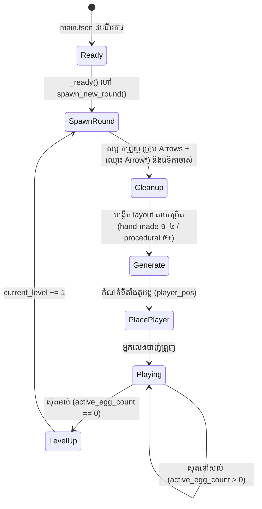
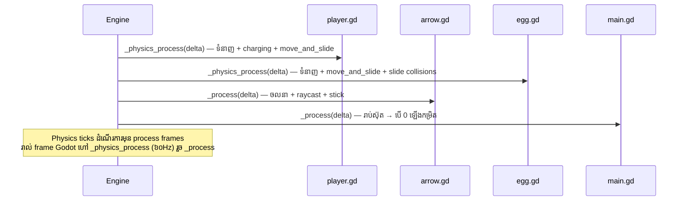

# លំហូរហ្គេម និងវដ្តកម្រិត

ទំព័រនេះដើរតាម **វដ្តជីវិតពេញលេញ** នៃកម្រិតមួយ — ពីពេលហ្គេមចាប់ផ្តើម
រហូតដល់កម្រិតបន្ទាប់លេចឡើង។ កូដយោងទាំងអស់មកពី `Script/main.gd` (commit `a10b33c`)។

## វដ្តជីវិតកម្រិត (Level Lifecycle)



## ជំហានទី ១ — ចាប់ផ្តើម (`_ready`)

```gdscript
# main.gd បន្ទាត់ ២០–២២
func _ready() -> void:
    spawn_new_round()   # current_level ចាប់ផ្តើមពី ១
```

## ជំហានទី ២ — សម្អាតរបស់ចាស់ (`spawn_new_round` ផ្នែកដំបូង)

មុនបង្កើតកម្រិតថ្មី កូដសម្អាត **៣ ប្រភេទ**៖

```gdscript
# main.gd បន្ទាត់ ២៦–៤៧
# (១) ព្រួញទាំងអស់ក្នុងក្រុម "Arrows" — រួមទាំងព្រួញដែលខ្ទប់ជាប់វេទិកា/ដី
for node in get_tree().get_nodes_in_group("Arrows"):
    if is_instance_valid(node):
        node.queue_free()

# (២) កូន node របស់ current_scene ដែលឈ្មោះចាប់ផ្តើមដោយ "Arrow"
#     (បម្រុងទុក — ព្រួញ reparent អាចមានឈ្មោះផ្សេង ដូចជា "@Arrow@...")
for child in get_tree().current_scene.get_children():
    if child.name.begins_with("Arrow") and is_instance_valid(child):
        child.queue_free()

# (៣) វេទិកាឈើទាំងអស់ពីកម្រិតមុន (តាម array current_bases)
for base in current_bases:
    if is_instance_valid(base):
        base.queue_free()
current_bases.clear()
```

!!! info "ហេតុអ្វីត្រូវសម្អាតពីររបៀប (ក្រុម + ឈ្មោះ)?"
    ព្រួញដែលខ្ទប់ត្រូវបាន reparent ទៅ collider (ឧ. ដី `StaticBody2D`)។
    ការសម្អាតតាមក្រុមគ្របដណ្តប់ព្រួញទាំងអស់ ប៉ុន្តែ loop ទីពីរជាសំណាញ់បម្រុង
    (safety net) សម្រាប់ node ដែលឈ្មោះដើមដោយ "Arrow"។
    សំណុំទាំងពីរមានក្នុងកូដពិត (បន្ទាត់ ២៦–៣៨)។

## ជំហានទី ៣ — បង្កើត layout តាមកម្រិត

### កម្រិតរចនាដោយដៃ (១–៤)

តារាងខាងក្រោមផ្ទៀងផ្ទាត់ពី `main.gd` បន្ទាត់ ៥៣–៧៥៖

| កម្រិត | ទីតាំងតួអង្គ | ទីតាំងស៊ុត | វេទិកាឈើ | គោលបំណងបង្រៀន |
| --- | --- | --- | --- | --- |
| ១ | (150, 520) — ឆ្វេង | (950, 520) — ស្តាំ នៅលើដី | ❌ | បាញ់ត្រង់ផ្ទៃរាប |
| ២ | (1100, 520) — ស្តាំ | (150, 520) — ឆ្វេង នៅលើដី | ❌ | បាញ់ត្រឡប់ទិស |
| ៣ | (1100, 520) — ស្តាំ | (250, 350) — ឆ្វេង **លើខ្ពស់** | ✅ | គណនាគន្លងកោង + វេទិកា |
| ៤ | (575, 520) — កណ្តាល | (300, 380) និង (850, 380) — សងខាង | ✅ (២) | បាញ់គោលដៅពីរ |

### កម្រិតស្វ័យប្រវត្តិ (៥ ឡើងទៅ)

សូមមើលមេរៀនពេញលេញនៅ [ការបង្កើតកម្រិតស្វ័យប្រវត្តិ](../lessons/levels.md)។
សង្ខេប៖

```gdscript
# main.gd បន្ទាត់ ៧៩–៨១ — seed តាមរូបមន្ត → layout អាចទាយបាន (deterministic)
var unique_seed = current_level * 4861 + current_level * 239 + 41
seed(unique_seed)
```

- ទីតាំងតួអង្គ៖ ឆ្វេង (120) ឬ ស្តាំ (1150) ឆ្លាស់គ្នាតាម `current_level % 2`
- ចំនួនស៊ុត៖ `clampi(2 + level/4, 2, 4)` → កម្រិត ៥–៧ = ៣ ស៊ុត, កម្រិត ៨+ = ៤ ស៊ុត
- ទីតាំងស៊ុត៖ "ច្រក" x ៤ `[320, 520, 720, 920]` × កម្ពស់ ៣ `[200, 310, 420]` (shuffle ទាំងពីរ)
- វេទិកាផ្លាស់ទី៖ ចាប់ពីកម្រិត ៨ (`use_mov = current_level >= 8`)

## ជំហានទី ៤ — ដាក់តួអង្គ

```gdscript
# main.gd បន្ទាត់ ១១៩–១២២
if player:
    player.global_position = player_pos   # y = 520 ជានិច្ច
```

## ជំហានទី ៥ — ការលេង និងការបំផ្លាញស៊ុត

អំឡុងពេលលេង `egg.gd` ដឹងពីការបំផ្លាញខ្លួនឯង៖

1. ព្រួញប៉ះ → `take_damage()` → `current_hits += 1` → frame ប្រេះ
2. `current_hits >= 3` → `is_destroyed = true`
3. លុបព្រួញទាំងអស់ដែលជាប់ក្នុងស៊ុត (`hit_arrows`)
4. `queue_free()` — ស៊ុតចេញពី scene tree **និង** ពីក្រុម `"eggs"`

## ជំហានទី ៦ — រាប់ស៊ុត និងឡើងកម្រិត

```gdscript
# main.gd បន្ទាត់ ២១៤–២៣២ (polling រាល់ frame)
func _process(_delta: float) -> void:
    var remaining_eggs = get_tree().get_nodes_in_group("eggs")
    var active_egg_count = 0
    for egg in remaining_eggs:
        # ពិនិត្យទាំង valid និង មិនទាន់ queued for deletion
        if is_instance_valid(egg) and not egg.is_queued_for_deletion():
            active_egg_count += 1
    if active_egg_count == 0:
        current_level += 1
        spawn_new_round()
```

!!! warning "ហេតុអ្វី `is_queued_for_deletion()` សំខាន់?"
    `queue_free()` មិនលុប node ភ្លាមៗទេ — វាលុបនៅ **ចុង frame**។
    បើគ្មានការពិនិត្យនេះ ស៊ុតដែល "ស្លាប់ហើយ" នៅតែត្រូវបានរាប់
    ក្នុង frame ចុងក្រោយ ហើយកម្រិតមិនបន្ទាប់ភ្លាមទេ។
    ប៉ុន្តែចំណុចសំខាន់ជាងនេះ៖ frame *បន្ទាប់* ស៊ុតចេញពីក្រុមរួចហើយ
    ដូច្នេះការរាប់នឹងទៅ ០ យ៉ាងត្រឹមត្រូវ។

## Timeline ពេញលេញនៃ frame មួយ



!!! note "_physics_process vs _process ក្នុងគម្រោងនេះ"
    - `player.gd` និង `egg.gd` ប្រើ `_physics_process` — ព្រោះពួកវាប្រើ
      `move_and_slide()` ដែលត្រូវការ physics tick ទៀងទាត់
    - `arrow.gd` និង `main.gd` ប្រើ `_process` — ព្រួញគណនាចលនាខ្លួនឯង
      (មិនប្រើ physics engine) ហើយ main គ្រាន់តែរាប់ node
    - នេះមានន័យថា **ព្រួញហោះតាម frame rate** (variable delta) ចំណែក
      **ស៊ុតធ្លាក់តាម physics tick** (fixed 60Hz) — ភាពខុសគ្នាដ៏តូចមួយដែល
      អ្នកសិក្សាគួរដឹង (មិនមែនជា bug ដែលប៉ះពាល់ការលេងជាក់ស្តែងទេ)។

## អ្វីដែល *មិនមាន* ក្នុងវដ្តនេះ

ផ្ទៀងផ្ទាត់ដោយការអាន `main.gd` ទាំងស្រុង៖

- ❌ គ្មាន HUD/UI បង្ហាញលេខកម្រិត (អ្នកលេងមិនដឹងទេថានៅកម្រិតណា!)
- ❌ គ្មានការរក្សាទុក (save/load) — បិទហ្គេម = ចាប់ពីកម្រិត ១
- ❌ គ្មាន game over / win state
- ❌ គ្មានការកំណត់ចំនួនព្រួញ

ទាំងនេះគឺជា **ឱកាសល្អសម្រាប់អ្នកសិក្សា** — មើល
[មេរៀនបង្រៀនជាក់ស្តែង](../tutorials/customize.md) ដើម្បីបន្ថែម Label បង្ហាញកម្រិត។

---

**បន្ទាប់៖** [តួអង្គ និងយន្តការបាញ់ព្រួញ →](../lessons/player.md)
