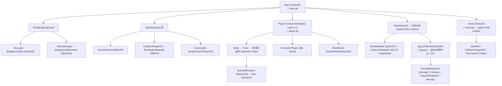
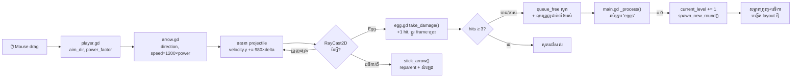

# ទិដ្ឋភាពទូទៅនៃប្រព័ន្ធ

ទំព័រនេះបង្ហាញ **ស្ថាបត្យកម្មពេញលេញ** របស់ Target Quest — ពី scene tree
រហូតដល់លំហូរទិន្នន័យរវាងស្គ្រីប។ រាល់ធាតុទាំងអស់ផ្ទៀងផ្ទាត់ពីឯកសារពិតនៅ commit `a10b33c`។

## Scene tree ពេលលេង (Runtime)

រូបភាពខាងក្រោមបង្ហាញដើមឈើ node ពេលហ្គេមដំណើរការកម្រិតដែលមានវេទិកា៖



!!! note "អ្វីដែលមានតែពេល runtime"
    - **វេទិកាឈើ និងសុត** — `main.gd` instantiate ពួកវាតាមកម្រិត (`spawn_level_entities()`)
    - **ព្រួញ** — `player.gd` instantiate ពេលចាប់ផ្តើមទាញ (`start_charge()`) ម្តងមួយដើម
    - **ព្រួញដែលខ្ទប់** — reparent ខ្លួនឯងពី `Main` ទៅវត្ថុដែលវាបុក (`stick_arrow()`)

## តារាងទំនាក់ទំនងឯកសារ

| ឯកសារ scene | Script | ប្រភេទ root | ត្រូវបានប្រើដោយ |
| --- | --- | --- | --- |
| `main.tscn` | `main.gd` | `Node2D` | ជា scene ដែលអ្នកដំណើរការ (មិនមាន auto main scene) |
| `player.tscn` | `player.gd` | `CharacterBody2D` | instance នៅក្នុង `main.tscn` (តំណែង editor (168, 509) — ត្រូវបានកំណត់ឡើងវិញដោយ `main.gd`) |
| `arrow.tscn` | `arrow.gd` | `Area2D` | `player.gd` (តាម `@export arrow_scene` — កំណត់ក្នុង `player.tscn`) |
| `egg.tscn` | `egg.gd` | `CharacterBody2D` | `main.gd` (តាម `@export egg_scene` — កំណត់ក្នុង `main.tscn`) |
| `wooden_base.tscn` | — | `StaticBody2D` | `main.gd` (តាម `@export wooden_base_scene`) |
| `monster.tscn` | — | `CharacterBody2D` | ⚠️ គ្មានអ្វីប្រើ + ខូច (missing textures) |

## លំហូរទិន្នន័យ — ពីកណ្តុរដល់កម្រិតថ្មី



## គោលការណ៍រចនាសំខាន់ៗ (Design Patterns)

### ១. Group-based communication ជំនួសឱ្យ direct references

ស្គ្រីបមិនយោងគ្នាតាម node path ទេ — ពួកវាប្រើ **groups**៖

- `main.gd` សម្អាតព្រួញទាំងអស់តាម `get_nodes_in_group("Arrows")`
- `main.gd` រាប់សុតតាម `get_nodes_in_group("eggs")`
- `egg.gd` ស្គាល់ព្រួញតាម `collider.is_in_group("Arrows")`

អត្ថប្រយោជន៍៖ អាចបង្កើត/លុប node ច្រើនដោយសេរី ដោយមិនខូច reference។

### ២. Duck typing តាម `has_method()`

ជំនួសឱ្យការកំណត់ interface/base class ព្រួញហៅ៖

```gdscript
# arrow.gd បន្ទាត់ ៧១–៧២ — បើ collider មាន take_damage ហៅវា
if collider and collider.has_method("take_damage"):
    collider.take_damage(self)
```

វត្ថុណាដែលមាន `take_damage()` អាចទទួលការខូចខាត — ដោយមិនចាំបាច់ inherit ពី class រួម។

### ៣. Reparenting ដើម្បី "ខ្ទប់" ព្រួញ

ព្រួញមិនប្រើ physics joint ទេ។ វា **ប្តូរ parent** ទៅវត្ថុដែលវាបុក
ដោយរក្សា `global_transform` (ទីតាំង/ការបង្វិលក្នុងពិភពលោកមិនប្រែ)៖

```gdscript
# arrow.gd បន្ទាត់ ១០៩–១១៨
var global_trans = global_transform  # រក្សាទុកមុន
get_parent().remove_child(self)      # ដកចេញពី parent ចាស់
collider.add_child(self)             # ភ្ជាប់ទៅ collider
global_transform = global_trans      # ស្តារទីតាំង — មិនលោត!
```

លទ្ធផល៖ ព្រួញផ្លាស់ទីតាមវេទិកាដែលរំកិល ដោយស្វ័យប្រវត្តិ។

### ៤. Polling ជំនួសឱ្យ event ដើម្បីដឹងកម្រិតចប់

`main.gd` មិនរង់ចាំ signal ពីសុតទេ — វា **រាប់សុតរាល់ frame**៖

```gdscript
# main.gd បន្ទាត់ ២១៤–២៣២
func _process(_delta: float) -> void:
    var remaining_eggs = get_tree().get_nodes_in_group("eggs")
    var active_egg_count = 0
    for egg in remaining_eggs:
        if is_instance_valid(egg) and not egg.is_queued_for_deletion():
            active_egg_count += 1
    if active_egg_count == 0:
        current_level += 1
        spawn_new_round()
```

!!! info "ចំណាំពីសវនកម្ម"
    `egg.gd` (បន្ទាត់ ១០០–១០៣) ព្យាយាមហៅ `_on_egg_destroyed()` លើ current scene
    ប៉ុន្តែ `main.gd` **មិនមាន** method នោះទេ — ដូច្នេះការហៅនោះមិនកើតឡើងទេ
    (ការពារដោយ `has_method()`)។ យន្តការពិតដែលធ្វើឱ្យកម្រិតបន្ទាប់លេចឡើង
    គឺ **polling** ខាងលើ។ ឯកសារនេះពន្យល់តាមយន្តការពិត។

## ប្រព័ន្ធសំឡេង

គ្មាន audio bus ផ្ទាល់ខ្លួន ឬ music ទេ — មានតែ `AudioStreamPlayer2D` ៤ តួ
ដែលលេងតាមព្រឹត្តិការណ៍៖

| Node | ឯកសារសំឡេង | ស្ថិតនៅ | លេងពេល |
| --- | --- | --- | --- |
| `ShootAudio` | `Bow_Shoot.wav` | `player.tscn` | បាញ់ព្រួញ (`release_arrow()`) |
| `HitAudio` | `Egg_Hit.wav` | `egg.tscn` | សុតត្រូវព្រួញ (`take_damage()`) |
| `BaseAudio` | `Base.wav` | `wooden_base.tscn` | ព្រួញខ្ទប់វេទិកាឈើ |
| `GrassAudio` | `Grass.wav` | `main.tscn` (ដី) | ព្រួញខ្ទប់ដីស្មៅ |

ចំណុចឆ្លាត៖ `arrow.gd` មិនចាំបាច់ស្គាល់ប្រភេទវត្ថុទេ — វាគ្រាន់តែពិនិត្យ
`collider.has_node("BaseAudio")` → `"GrassAudio"` → `"HitAudio"` (បន្ទាត់ ៩៨–១០៦)។
នេះជា **convention-based** audio ជំនួសឱ្យ type-based។

📖 [AudioStreamPlayer2D](https://docs.godotengine.org/en/4.3/classes/class_audiostreamplayer2d.html) · [Audio buses](https://docs.godotengine.org/en/4.3/tutorials/audio/audio_buses.html)

---

**បន្ទាប់៖** [លំហូរហ្គេម និងវដ្តកម្រិត →](game-loop.md)
