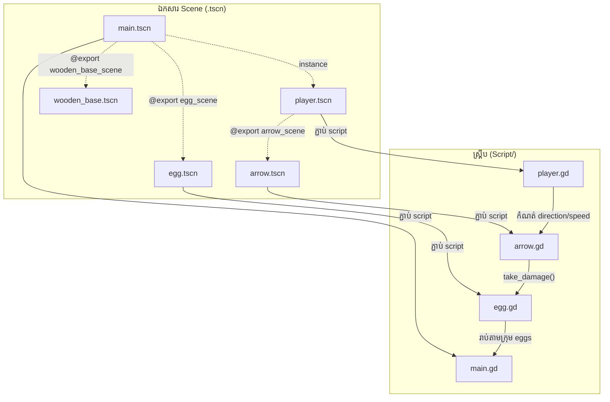

# រចនាសម្ព័ន្ធគម្រោង

ទំព័រនេះពន្យល់ឯកសារ/ថតនីមួយៗក្នុង repository និងតួនាទីពិតរបស់វា
(ផ្ទៀងផ្ទាត់ពី commit `a10b33c` ថ្ងៃ 2026-10-23)។

## ផែនទីថត (Directory Map)

```
Target-Quest/
├── project.godot          ← ការកំណត់គម្រោង Godot (ឈ្មោះ version វីនដូ renderer)
├── README.md              ← ការណែនាំគម្រោងដើម (អង់គ្លេស)
├── LICENSE                ← MIT License (កូដ) © 2026 KernelVoltage
├── ASSETS_LICENSE.md      ← License រូបភាព/សំឡេង (អប់រមប៉ុណ្ណោះ!)
├── Icon.png               ← រូបតំណាងគម្រោង (1024×1024)
├── Image1.png, Image2.png ← រូបថតអេក្រង់សម្រាប់ README
│
├── Script/                ← កូដ GDScript ទាំងអស់ (៥ ឯកសារ)
│   ├── main.gd            ← អ្នកគ្រប់គ្រងកម្រិត — បង្កើត/សម្អាត/រាប់សុត (២៣២ បន្ទាត់)
│   ├── player.gd          ← តួអង្គ — ការទាញធ្នូ បាញ់ គន្លងទាយ (២៤២ បន្ទាត់)
│   ├── arrow.gd           ← ព្រួញ — ចលនា ការប៉ះ ការខ្ទប់ (១២១ បន្ទាត់)
│   ├── egg.gd             ← សុត — សុខភាព animation ប្រេះ ការបំផ្លាញ (១០៦ បន្ទាត់)
│   └── target.gd          ← ⚠️ មិនប្រើ (dead code — មើលខាងក្រោម)
│
├── Scenes/                ← ឯកសារ scene (.tscn)
│   ├── main.tscn          ← scene មេ — ផ្ទៃមេឃ/ភ្នំ ដី តួអង្គ
│   ├── player.tscn        ← តួអង្គ + ធ្នូ + AnimationPlayer (idle/shoot)
│   ├── arrow.tscn         ← ព្រួញ (Area2D + RayCast2D)
│   ├── egg.tscn           ← សុត (AnimatedSprite2D ៤ frame ប្រេះ)
│   ├── wooden_base.tscn   ← វេទិកាឈើ (StaticBody2D)
│   ├── monster.tscn       ← ⚠️ ខូច (យោងរូបភាពដែលគ្មាន — មើលខាងក្រោម)
│   └── mai19EC.tmp        ← ⚠️ temp file ដែល Godot editor បន្សល់ទុក
│
└── Free_Asset_Pack/       ← រូបភាព និងសំឡេង (license អប់រមប៉ុណ្ណោះ)
    ├── Bow.png            ← ធ្នូ
    ├── arrow.png          ← ព្រួញ
    ├── Characters/        ← ផ្នែករាងកាយតួអង្គ (Head, Torso, ដៃ ជើង...) ១២ ឯកសារ
    ├── Environment/       ← ផ្ទៃមេឃ ភ្នំ ដីស្មៅ ដី វេទិកាឈើ ៥ ឯកសារ
    ├── Props/             ← សុត ៤ ដំណាក់កាលប្រេះ (egg_stage_0..3)
    └── SFX/               ← សំឡេង ៤ — Base.wav, Bow_Shoot.wav, Egg_Hit.wav, Grass.wav
```

## តួនាទីស្គ្រីប និងទំនាក់ទំនង



| ឯកសារ | ភ្ជាប់ជាមួយ | ទំនាក់ទំនង |
| --- | --- | --- |
| `main.gd` | `player.gd` | កំណត់ទីតាំងតួអង្គរាល់កម្រិត (`player.global_position`) |
| `main.gd` | `egg.gd` | ហៅ `set_egg_health()`; រាប់សុតតាមក្រុម `"eggs"` |
| `player.gd` | `arrow.gd` | បង្កើត/កាន់/បាញ់ព្រួញ; កំណត់ `direction`, `speed`, `is_stuck` |
| `arrow.gd` | `egg.gd` | ហៅ `take_damage()` បើ collider មាន method នោះ (duck typing) |
| `arrow.gd` | វេទិកា/ដី | reparent ខ្លួនឯងទៅ collider; លេងសំឡេងតាម node កូន (`BaseAudio`/`GrassAudio`) |

## ការពន្យល់ឯកសារ configuration

### `project.godot`

```ini
config_version=5

[application]
config/name="Target Quest"
config/features=PackedStringArray("4.3", "GL Compatibility")  # ← បង្កើតដោយ Godot 4.3
config/icon="res://Icon.png"

[display]
window/size/viewport_width=1280    # ទទឹងវីនដូ
window/size/viewport_height=720    # កម្ពស់វីនដូ
window/stretch/mode="canvas_items" # ពង្រីក UI/រូបភាពតាមវីនដូ
window/stretch/aspect="expand"     # រក្សាសមាមាត្រ ពង្រីកផ្ទៃមើល

[rendering]
renderer/rendering_method="gl_compatibility"        # OpenGL — សម្រាប់ម៉ាស៊ីនចាស់/web
renderer/rendering_method.mobile="gl_compatibility"
```

!!! note "ចំណុចសំខាន់ដែល *គ្មាន* ក្នុងឯកសារនេះ"
    - គ្មាន `run/main_scene` → ត្រូវបើក `main.tscn` ដោយដៃ (F6) ឬ Godot នឹងសួរពេលចុច F5
    - គ្មានផ្នែក `[physics]` → ទំនាញប្រើតម្លៃលំនាំដើម **980**
    - គ្មាន `[input]` map → input ទាំងអស់ជា raw mouse events ក្នុង `_input()`

### `.gitattributes` និង `.gitignore`

`.gitignore` រួមបញ្ចូល `.godot/` (import cache) និង `*.tmp`។

!!! info "ចំណាំអំពី `.gitattributes`"
    ឯកសារនេះមាន `* export-ignore` និងបន្ទាត់ `export=false` មួយចំនួន។
    `export-ignore` ជា attribute សម្រាប់ GitHub (មិនរួមបញ្ចូលក្នុង ZIP download)
    ចំណែក `export=false` **មិនមែន** ជា attribute ស្តង់ដាររបស់ Git/Godot ទេ —
    វាមិនមានឥទ្ធិពលអ្វីទេ។ នេះជាការកត់សម្គាល់ពីសវនកម្ម មិនមែនជាបញ្ហាធ្ងន់ធ្ងរទេ។

## ⚠️ ឯកសារដែលមានបញ្ហា (ផ្ទៀងផ្ទាត់ដោយការសវនកម្ម)

### ១. `Scenes/monster.tscn` — scene ខូច

ឯកសារនេះយោងរូបភាព ១១ ក្នុង `Free_Asset_Pack/NPC/` (Torso, Head, ដៃ ជើង...)
ប៉ុន្តែ**ថត `NPC/` មិនមានក្នុង repository ទេ** (ផ្ទៀងផ្ទាត់៖ `ls Free_Asset_Pack/`
បង្ហាញតែ `Characters`, `Environment`, `Props`, `SFX`, `Bow.png`, `arrow.png`)។
បើអ្នកបើក scene នេះក្នុង editor វានឹងបង្ហាញកំហុស missing resource។
វាក៏មិនត្រូវបាន instance ដោយ scene/script ណាដែរ (`grep monster` គ្មានលទ្ធផល)។

### ២. `Script/target.gd` — dead code

ស្គ្រីបនេះមិនត្រូវបានភ្ជាប់ទៅ scene ណាមួយទេ (`grep target.gd *.tscn` គ្មានលទ្ធផល)។
វាហៅក្រុម `"level_manager"` និង method `check_level_completion()` ដែល
**មិនមាន** ក្នុង `main.gd`។ វាក៏មាន comment ជាភាសា Hindi ផង
("Level manager ko check karwane ke liye...") ដែលបង្ហាញថាវាជាសំណល់ពីការពិសោធន៍។

### ៣. `Scenes/mai19EC.tmp` — temp file

ច្បាប់ចម្លងចាស់របស់ `main.tscn` (version ដែលគ្មាន script និងគ្មាន wooden_base/egg_scene)
ដែល Godot editor បន្សល់ទុក ហើយត្រូវបាន commit ដោយចៃដន្យ។ មិនប៉ះពាល់ដំណើរការទេ។

!!! tip "ការសម្រេចចិត្តរបស់គម្រោងឯកសារខ្មែរ"
    តាមការសម្រេចចិត្តរបស់ម្ចាស់ fork ឯកសារទាំង ៣ នេះត្រូវបាន **ទុកដដែល**
    (មិនលុប) ដើម្បីរក្សាភាពស្របគ្នាជាមួយ upstream — ការលុបអាចបង្កើត
    merge conflict ពេល sync។ គ្រាន់តែ **កុំបើក** `monster.tscn`។

---

**បន្ទាប់៖** [ទិដ្ឋភាពទូទៅនៃប្រព័ន្ធ →](../architecture/overview.md)
