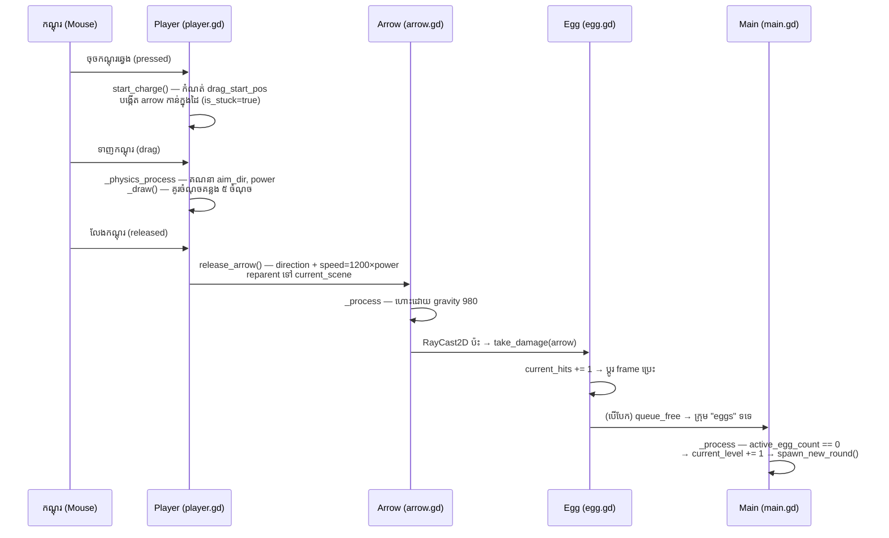

# ដំណើរការ និងលេងហ្គេម

## ដំណើរការហ្គេម

!!! warning "ចំណុចសំខាន់ដែលត្រូវដឹង"
    គម្រោងនេះ **មិនបានកំណត់ main scene** ក្នុង `project.godot` ទេ
    (គ្មាន key `run/main_scene` — ផ្ទៀងផ្ទាត់ដោយការអានឯកសារពេញលេញ)។
    ដូច្នេះបើអ្នកចុច F5 ភ្លាមៗ Godot នឹងសួរអ្នកឱ្យជ្រើសរើស main scene។

**ជំហាន៖**

1. នៅក្នុង FileSystem dock ចុចពីរដងលើ **`Scenes/main.tscn`** ដើម្បីបើកវា
2. ដំណើរការហ្គេម៖
    - ចុច **F6** (Run Current Scene) — ដំណើរការ scene ដែលកំពុងបើក, **ឬ**
    - ចុច **F5** → Godot នឹងសួរ "Current scene not set as main scene — use it?"
      → ចុច **Yes/Select** ហើយវានឹងកំណត់ `main.tscn` ជា main scene
3. វីនដូហ្គេម 1280×720 នឹងលេចឡើង

អ្វីដែលអ្នកនឹងឃើញ៖ ផ្ទៃមេឃ និងភ្នំ (ParallaxBackground) ដីស្មៅនៅខាងក្រោម
តួអង្គដែលកាន់ធ្នូ និងសុតមួយនៅខាងស្តាំ (កម្រិត ១ ដាក់សុតនៅ `(950, 520)`
ហើយតួអង្គនៅ `(150, 520)` — ពី `main.gd` បន្ទាត់ ៥៥–៥៧)។

## ការគ្រប់គ្រង (Controls)

| សកម្មភាព | របៀបធ្វើ | កូដយោង |
| --- | --- | --- |
| ចាប់ផ្តើមទាញធ្នូ | ចុចកណ្តុរឆ្វេង (គ្រប់ទីកន្លែងលើវីនដូ) | `player.gd` `_input()` បន្ទាត់ ១០៨–១១៧ |
| កំណត់ទិសដៅ | ទាញកណ្តុរ — ព្រួញបាញ់ **ផ្ទុយទិស** ទាញ | `aim_dir = -drag_vector.normalized()` បន្ទាត់ ៥៩ |
| កំណត់កម្លាំង | ទាញឱ្យឆ្ងាយ (អតិបរមា ២០០ px = ១០០%) | `max_drag_distance` បន្ទាត់ ២០ |
| បាញ់ | លែងកណ្តុរ | `release_arrow()` បន្ទាត់ ១៩០ |

## សាកល្បងដំបូង

1. ទាញកណ្តុរពីតួអង្គទៅ **ខាងឆ្វេង-ក្រោម** បន្តិច រួចលែង —
   ព្រួញនឹងហោះទៅ **ស្តាំ-លើ** ជាកាំភ្លើងកោង
2. សង្កេត **ចំណុចស ៥** ពេលកំពុងទាញ — វាបង្ហាញគន្លងដែលនឹងហោះ
   (កូដពិត៖ រូបមន្ត `sim_pos = start + dir·speed·t + ½·g·t²` ក្នុង `_draw()`)
3. បាញ់សុត ៣ ដង — សុតនឹងប្រេះម្តងមួយៗ (រូបភាព `egg_stage_0` → `egg_stage_3`)
   ហើយបែកនៅដងទី ៣
4. សុតបែកអស់ → អេក្រង់ "reset" ភ្លាមៗ — នោះគឺ **កម្រិត ២** ចាប់ផ្តើម
   (តួអង្គផ្លាស់ទៅខាងស្តាំ `(1100, 520)` សុតនៅខាងឆ្វេង)
5. នៅកម្រិត ៣ អ្នកនឹងឃើញ **វេទិកាឈើ** លើកដំបូង — ព្រួញដែលបុកវានឹងខ្ទប់ជាប់
   ហើយមានសំឡេង "ឈើ" (`Base.wav`)

## អ្វីដែលត្រូវសង្កេត (សម្រាប់ការសិក្សា)

- **កម្រិត ៥+** — ការរៀបចំប្រែប្រួលជារៀងរាល់កម្រិត ប៉ុន្តែ **កម្រិតដដែលតែងរៀបចំដូចគ្នា**
  (deterministic seed)។ ចេញពីហ្គេម ហើយលេងម្តងទៀតដល់កម្រិត ៥ — អ្នកនឹងឃើញ layout ដូចគ្នា។
- **កម្រិត ៨+** — វេទិកាឈើខ្លះចាប់ផ្តើម **ផ្លាស់ទីឡើង-ចុះ** យឺតៗ (Tween sine)។
  សុតនៅលើវេទិកាផ្លាស់ទីតាម ព្រោះវាជា child node របស់វេទិកា។
- **ព្រួញខ្ទប់ជាប់វេទិកាដែលផ្លាស់ទី** — សាកល្បងបាញ់វេទិកាដែលកំពុងរំកិល ហើយសង្កេត
  ព្រួញរំកិលតាម។ នេះគឺដោយសារ `stick_arrow()` reparent ព្រួញទៅ collider។

!!! tip "ពិសោធន៍លឿន"
    ចង់សាកការកែប្រែដំបូងរបស់អ្នក? មើល
    [មេរៀនបង្រៀនជាក់ស្តែង — កែប្រែហ្គេម](../tutorials/customize.md)។

---

**បន្ទាប់៖** [គោលគំនិត Godot ដែលប្រើក្នុងគម្រោង →](../fundamentals/godot-concepts.md)
