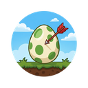
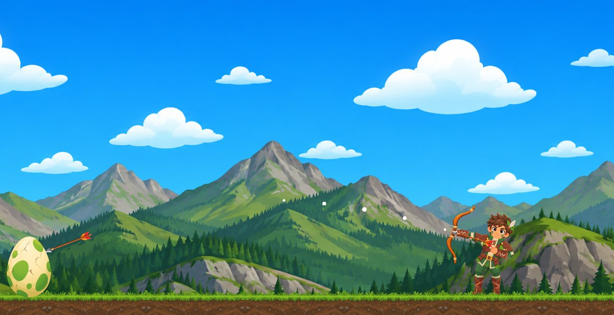
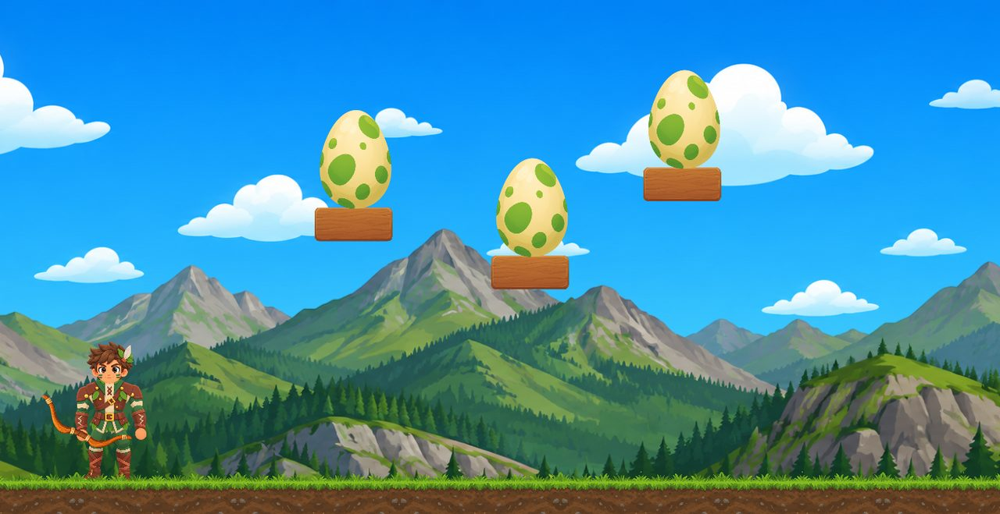
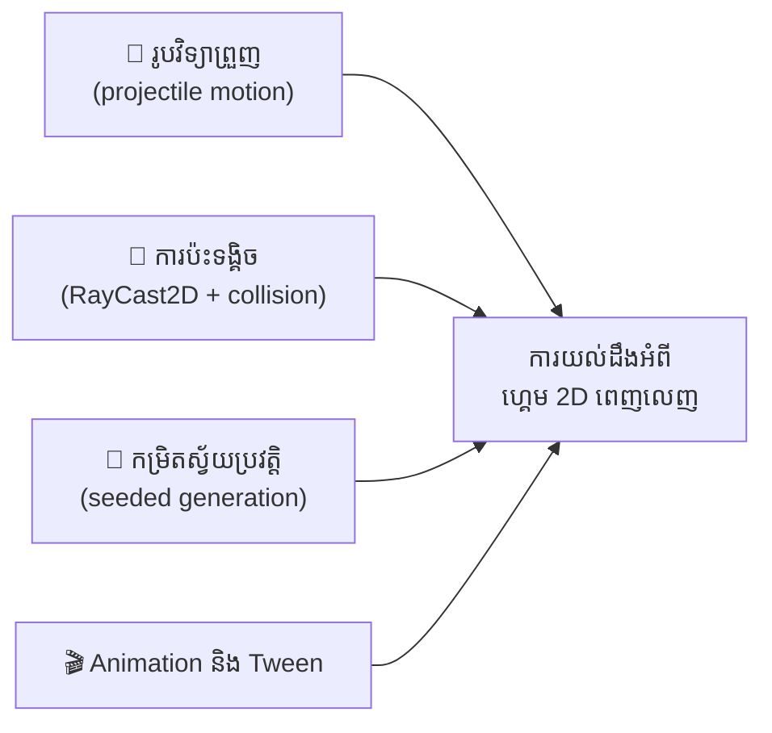
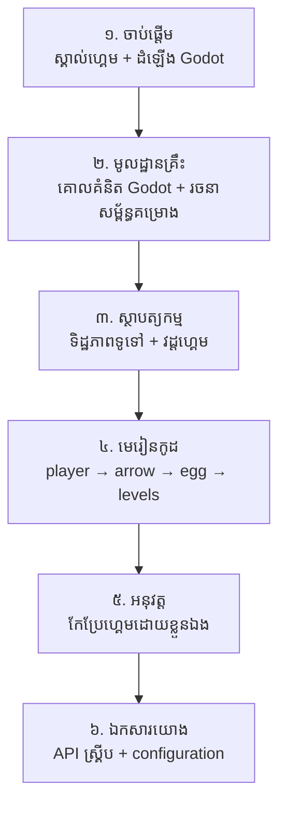

# Target Quest — ឯកសារសិក្សាភាសាខ្មែរ

{ width="100" align="right" }

សូមស្វាគមន៍! នេះគឺជា **ឯកសារសិក្សាភាសាខ្មែរ** សម្រាប់គម្រោងហ្គេម
[**Target Quest**](https://github.com/KernelVoltage/Target-Quest) — ហ្គេមបាញ់ព្រួញ 2D
ដែលសាងសង់ដោយ **Godot Engine 4.3** ជាភាសា **GDScript**។

!!! warning "កំណត់សម្គាល់សំខាន់"
    ឯកសារនេះជា **គម្រោងឯករាជ្យមិនផ្លូវការ** រៀបចំឡើងដោយ
    [SeyhaLite](https://github.com/SeyhaLite) ក្នុងគោលបំណងអប់រម។
    វាមិនមែនជាឯកសារផ្លូវការរបស់ KernelVoltage (អ្នកបង្កើតដើម) ទេ។
    កូដដើមស្ថិតនៅក្រោម **MIT License** ហើយរូបភាព/សំឡេងក្នុង `Free_Asset_Pack`
    អនុញ្ញាតតែការប្រើប្រាស់ **អប់រម និងមិនមែនពាណិជ្ជកម្ម** ប៉ុណ្ណោះ
    (មើល [ASSETS_LICENSE.md](https://github.com/SeyhaLite/Target-Quest-Khmer-Docs/blob/main/ASSETS_LICENSE.md))។

## ហ្គេមនេះជាអ្វី?

**Target Quest** គឺជាហ្គេមបាញ់ព្រួញបែបរូបវិទ្យា (physics-based archery)៖
មានអ្នកគ្រប់គ្រងតួអង្គម្នាក់ដែលមានធ្នូ ហើយត្រូវបាញ់កម្ទេច **សុត (eggs)**
ដែលដាក់តាំង លើវេទិកាឈើ ឬលើដី។ ពេលកម្ទេចសុតអស់ ហ្គេមនឹងបង្កើតកម្រិតថ្មី
ដោយស្វ័យប្រវត្តិគ្មានទីបញ្ចប់ (infinite procedural levels)។

|  |  |
| :---: | :---: |
| រូបថតអេក្រង់ពីគម្រោងដើម — យន្តការធ្នូ និងគន្លងព្រួញ | រូបថតអេក្រង់ពីគម្រោងដើម — កម្រិតដែលមានវេទិកាឈើច្រើន |

## អ្វីដែលអ្នកនឹងរៀនពីគម្រោងនេះ

គម្រោងនេះតូច (ស្គ្រីបតែ ៥ ប្រមាណ ៧០០ បន្ទាត់) ប៉ុន្តែបង្រៀនគោលគំនិត Godot ដ៏សំខាន់ៗជាច្រើន៖



- **រូបវិទ្យាហ្គេម 2D** — ទំនាញ (gravity) ល្បឿន (velocity) និងគន្លងកាំភ្លើង/ព្រួញ
- **ការបាញ់ព្រួញបែប slingshot** — ការគណនាទិសដៅ និងកម្លាំងពីការទាញកណ្តុរ
- **RayCast2D** — ការរកចំណុចប៉ះទង្គិចជាក់ស្តែង និងការធ្វើឱ្យព្រួញ "ខ្ទប់" នឹងវត្ថុ
- **Node grouping និង duck typing** — ការភ្ជាប់ប្រព័ន្ធរវាងស្គ្រីបដោយមិន coupling ខ្លាំង
- **ការបង្កើតកម្រិតស្វ័យប្រវត្តិ (procedural generation)** ដោយប្រើ `seed()` ដើម្បីឱ្យលទ្ធផលអាចទាយបាន (deterministic)
- **Tween animation** សម្រាប់វេទិកាផ្លាស់ទីរលូន
- **AudioStreamPlayer2D** សម្រាប់សំឡេងតាមប្រភេទផ្ទៃ

## ផ្លូវសិក្សាណែនាំ (Learning Path)



!!! tip "អ្នកចាប់ផ្តើមដំបូង"
    បើអ្នកមិនធ្លាប់ប្រើ Godot ទេ សូមចាប់ផ្តើមពី
    [ដំឡើង Godot Engine](getting-started/install-godot.md) ហើយអាន
    [គោលគំនិត Godot](fundamentals/godot-concepts.md) មុនពេលចូលមេរៀនកូដ។
    បើអ្នកចេះ Godot ហើយ អាចចូល [ស្ថាបត្យកម្ម](architecture/overview.md) បានភ្លាម។

## ព័ត៌មានសង្ខេបអំពីគម្រោង

| ព័ត៌មាន | តម្លៃ (ផ្ទៀងផ្ទាត់ពីកូដ) |
| --- | --- |
| គម្រោងដើម (upstream) | [KernelVoltage/Target-Quest](https://github.com/KernelVoltage/Target-Quest) |
| Fork ឯកសារខ្មែរ | [SeyhaLite/Target-Quest-Khmer-Docs](https://github.com/SeyhaLite/Target-Quest-Khmer-Docs) |
| Commit ដែលឯកសារនេះយោង | `a10b33c` (ពិនិត្យថ្ងៃ 2026-10-23) |
| Engine | Godot 4.3 (GL Compatibility renderer) |
| ភាសាកូដ | GDScript |
| ទំហំវីនដូ | 1280×720 |
| License កូដ | MIT |
| License assets | អប់រម/មិនមែនពាណិជ្ជកម្មប៉ុណ្ណោះ |

## ការទាញយក និងដំណើរការឯកសារនេះនៅក្នុងម៉ាស៊ីនរបស់អ្នក

```bash
# ១. ទាញយក repository
git clone https://github.com/SeyhaLite/Target-Quest-Khmer-Docs.git
cd Target-Quest-Khmer-Docs

# ២. ដំឡើងឧបករណ៍ឯកសារ (Python 3.8+)
pip install -r docs/requirements.txt

# ៣. ដំណើរការម៉ាស៊ីនមើលឯកសារនៅ http://127.0.0.1:8000
mkdocs serve
```

---

*ឯកសារនេះសរសេរជាភាសាខ្មែរ ដោយរក្សាពាក្យបច្ចេកទេសភាសាអង់គ្លេសក្នុងវង់ក្រចក
ដើម្បីងាយស្រួលស្វែងរកឯកសារដើម។ ពាក្យដែលមិនច្បាស់ សូមមើល
[វចនានុក្រម](glossary.md)។*
