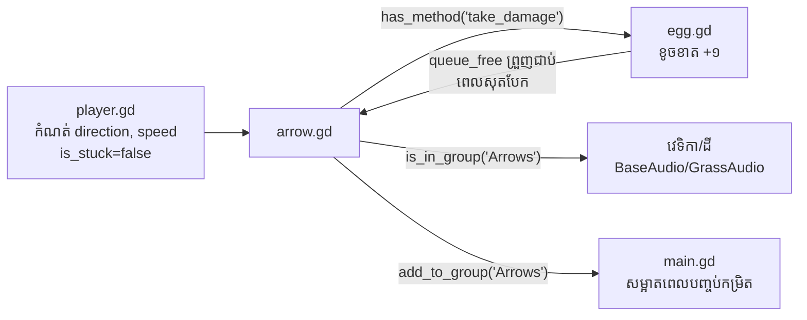

# ព្រួញ និងរូបវិទ្យា

**ឯកសារ៖** `Script/arrow.gd` (១២១ បន្ទាត់) + `Scenes/arrow.tscn`
**ប្រភេទ៖** `extends Area2D`

ព្រួញគឺជាចំណុចកណ្តាលនៃហ្គេមនេះ។ អ្វីដែលធ្វើឱ្យវាគួរឱ្យចាប់អារម្មណ៍៖
វា **មិនប្រើ physics engine** សម្រាប់ចលនាទេ — វាគណនា projectile motion
ដោយខ្លួនឯង ហើយប្រើ `RayCast2D` សម្រាប់រកការប៉ះទង្គិច។

## Scene structure របស់ព្រួញ (`arrow.tscn`)

```
Arrow (Area2D)              ← z_index = 1, ភ្ជាប់ arrow.gd
├── Arrow (Sprite2D)        ← រូបភាព arrow.png នៅ offset (-242, -2.1)
├── CollisionPolygon2D      ← polygon រាងព្រួញ (សម្រាប់ឱ្យ egg ប៉ះតាម move_and_slide)
└── RayCast2D               ← target_position = (145, 0) — ច្រមុះព្រួញ
```

## ១. អថេរ និងការរៀបចំ (`_ready`)

```gdscript
# arrow.gd បន្ទាត់ ៤–៣៦ (comment ខ្មែរ)
@export var speed: float = 800.0          # ល្បឿនលំនាំដើម (ត្រូវបានជំនួសដោយ player.gd → 1200×power)
var direction: Vector2 = Vector2.RIGHT    # ទិសដៅហោះ
var is_stuck: bool = false                 # ខ្ទប់ហើយឬនៅ?
var custom_gravity: float = ProjectSettings.get_setting("physics/2d/default_gravity")  # 980
var velocity: Vector2 = Vector2.ZERO      # វ៉ិចទ័រល្បឿន (ប្រែប្រួលតាមពេល)

@onready var ray_cast: RayCast2D = $RayCast2D

func _ready() -> void:
    # ចូលក្រុម "Arrows" — ឱ្យ main.gd និង egg.gd ស្គាល់
    add_to_group("Arrows")

    # ស្វែងរកតួអង្គដើម្បីដាក់ជា raycast exception (កុំឱ្យព្រួញខ្ទប់តួអង្គ)
    var player = get_tree().get_first_node_in_group("Player")
    if player and ray_cast:
        ray_cast.add_exception(player)
    # ⚠️ សវនកម្ម: ក្រុម "Player" មិនមាន node ណាចូលទេ → player = null
    #    ដូច្នេះ exception មិនដែលត្រូវបានដាក់ជាក់ស្តែង (dead code)

    # បើក raycast ឱ្យ detect Area ផង (លំនាំដើម detect តែ Body)
    if ray_cast:
        ray_cast.enabled = true
        ray_cast.collide_with_areas = true
```

!!! warning "dead code ដែលបានផ្ទៀងផ្ទាត់"
    ផ្នែក `get_first_node_in_group("Player")` មិនដំណើរការជាក់ស្តែងទេ ព្រោះ
    **គ្មាន node ណាត្រូវបានដាក់ក្នុងក្រុម `"Player"`** (ពិនិត្យ `player.tscn`
    និង `player.gd` ទាំងស្រុង — គ្មាន `groups=` ឬ `add_to_group`)។
    ផលវិបាកជាក់ស្តែងតិចតួច (ព្រួញហោះចេញឆ្ងាយពីតួអង្គ) ប៉ុន្តែបើអ្នកបាញ់
    ចុះក្រោមស្ទើរត្រង់ ព្រួញអាចខ្ទប់នឹង capsule របស់តួអង្គខ្លួនឯង។
    របៀបកែ៖ មើល [មេរៀនបង្រៀន ជំហានទី ៦](../tutorials/customize.md)។

## ២. ចលនាហោះ — `_process()`

```gdscript
# arrow.gd បន្ទាត់ ៣៩–៧៥ (comment ខ្មែរ)
func _process(delta: float) -> void:
    if is_stuck:
        return   # ខ្ទប់ហើយ → ឈប់ធ្វើចលនា

    # frame ដំបូង: បំប្លែង direction+speed ទៅជា velocity
    if velocity == Vector2.ZERO:
        velocity = direction.normalized() * speed

    # ទំនាញ — បន្ថែមល្បឿនបញ្ឈររាល់ frame (Euler integration)
    velocity.y += custom_gravity * delta   # custom_gravity = 980

    # ផ្លាស់ទីតាមល្បឿន
    position += velocity * delta

    # បង្វិលព្រួញតាមទិសហោះ (ច្រមុះព្រួញតម្រង់តាមគន្លង)
    rotation = velocity.angle()

    # ពិនិត្យការប៉ះទង្គិចតាម RayCast2D
    if ray_cast and ray_cast.is_colliding():
        var collider = ray_cast.get_collider()

        # ប៉ះព្រួញផ្សេង → រំលង (បន្ថែមជា exception ហើយហោះកាត់)
        if collider and collider.is_in_group("Arrows"):
            ray_cast.add_exception(collider)
            return

        # ចំណុចប៉ះជាក់ស្តែង (global coordinates)
        var hit_point = ray_cast.get_collision_point()

        # បើ collider មាន take_damage() (គឺសុត) → បង្កការខូចខាត
        if collider and collider.has_method("take_damage"):
            collider.take_damage(self)

        # ខ្ទប់ព្រួញនៅចំណុចប៉ះ
        stick_arrow(hit_point, collider)
```

### រូបវិទ្យានៅពីក្រោយ

នេះគឺជា **projectile motion** គណនាតាមវិធី Euler យ៉ាងសាមញ្ញ៖

$$v_y(t+\Delta t) = v_y(t) + g \cdot \Delta t$$
$$p(t+\Delta t) = p(t) + v(t+\Delta t) \cdot \Delta t$$

ដែល `g = 980 px/s²` (ទំនាញលំនាំដើម Godot — គម្រោងមិនកែ)។

លទ្ធផល៖ គន្លង **កោង parabola** — ព្រួញហោះឡើង រួចធ្លាក់ចុះវិញ។
`rotation = velocity.angle()` ធ្វើឱ្យព្រួញបង្វិលតាមគន្លង ដូចព្រួញពិត។

!!! info "ហេតុអ្វី RayCast2D ជំនួសឱ្យ collision signal របស់ Area2D?"
    `Area2D` មាន signal `area_entered`/`body_entered` ស្រាប់ ប៉ុន្តែព្រួញហោះលឿន
    (រហូត ១២០០ px/s ≈ ២០ px/frame)។ RayCast2D ប្រវែង **១៤៥ px** ពីចំណុចកណ្តាល
    ទៅច្រមុះ ធ្វើឱ្យការរកការប៉ះ (detect) មានភាពជាក់លាក់ខ្ពស់នៅចំណុចច្រមុះព្រួញ
    និងផ្តល់ `get_collision_point()` សម្រាប់ដាក់ទីតាំងខ្ទប់យ៉ាងត្រឹមត្រូវ។

## ៣. ការខ្ទប់ — `stick_arrow()`

```gdscript
# arrow.gd បន្ទាត់ ៧៨–១២១ (comment ខ្មែរ)
func stick_arrow(hit_point: Vector2, collider: Node) -> void:
    if is_stuck:
        return

    # បញ្ឈប់ចលនាទាំងស្រុង
    is_stuck = true
    speed = 0.0
    velocity = Vector2.ZERO

    # តម្រូវច្រមុះព្រួញឱ្យចំចំណុចប៉ះ
    # (RayCast2D នៅចំណុច origin របស់ព្រួញ ប៉ុន្តែរូបភាព offset -242px)
    var tip_pos = ray_cast.global_position
    var offset = global_position - tip_pos
    global_position = hit_point + offset

    # បន្ទាប z_index ឱ្យព្រួញនៅ *ក្រោយ* វត្ថុដែលវាបុក (ឥទ្ធិពលជ្រៀតចូល)
    z_index = -1

    if collider and is_instance_valid(collider):
        # លេងសំឡេងតាម node កូនដែល collider មាន (convention-based)
        if collider.has_node("BaseAudio"):
            collider.get_node("BaseAudio").play()      # វេទិកាឈើ → Base.wav
        elif collider.has_node("GrassAudio"):
            collider.get_node("GrassAudio").play()     # ដីស្មៅ → Grass.wav
        elif collider.has_node("HitAudio"):
            collider.get_node("HitAudio").play()       # សុត → Egg_Hit.wav

        # ★ ចំណុចសំខាន់បំផុត: reparent ទៅ collider
        var global_trans = global_transform  # រក្សាទីតាំង/បង្វិលពិភពលោក
        get_parent().remove_child(self)
        collider.add_child(self)             # ក្លាយជាកូនរបស់វត្ថុដែលបុក
        global_transform = global_trans      # ស្តារ — ព្រួញមិនលោតទីតាំង

    set_process(false)   # បិទ _process ទាំងស្រុង (សន្សំ performance)
```

### ហេតុអ្វី reparenting ឆ្លាត?

ពេលព្រួញក្លាយជា **កូន** របស់វេទិកាដែលផ្លាស់ទី (Tween កម្រិត ៨+)៖

- វេទិកាផ្លាស់ទី → ព្រួញផ្លាស់ទីតាម **ដោយស្វ័យប្រវត្តិ** (parent-child transform)
- មិនត្រូវការកូដបន្ថែមដើម្បីតាមដានទីតាំងទេ
- `global_transform` ត្រូវបានរក្សា ដូច្នេះមិនមានការលោតភ្លែត

!!! note "ផលវិបាក: ព្រួញជាប់សុត នឹងធ្លាក់តាមសុត"
    សុតគឺជា `CharacterBody2D` ដែលធ្លាក់ចុះតាមទំនាញបើគ្មានវេទិកា។
    ព្រួញដែលខ្ទប់នឹងសុត ក៏ធ្លាក់តាមដែរ (ព្រោះវាជាកូន)។ ឯព្រួញដែលខ្ទប់
    នឹងដី/វេទិកា នឹងនៅកន្លែង (StaticBody2D មិនផ្លាស់ទី)។ នេះជាឥទ្ធិពល
    ដែលកើតចេញពីការរចនា reparenting — មិនមានកូដពិសេសសម្រាប់វាទេ។

## ៤. អន្តរកម្មជាមួយប្រព័ន្ធផ្សេង



ផ្លូវខូចខាតមាន **ពីរ** (redundancy ក្នុងកូដពិត)៖

1. **RayCast របស់ព្រួញ** — `arrow.gd` ហៅ `collider.take_damage(self)` (បន្ទាត់ ៧១–៧២)
2. **Slide collision របស់សុត** — `egg.gd` `_physics_process()` ពិនិត្យ
   `get_slide_collision()` រក collider ក្នុងក្រុម `"Arrows"` ហើយហៅ `take_damage(collider)`
   (បន្ទាត់ ៥០–៥៦)

ការហៅស្ទួនមិនបង្កើតការខូចខាតទ្វេដងទេ ព្រោះ `take_damage()` មាន
**deduplication**៖ `if is_destroyed or damager in hit_arrows: return` —
ព្រួញដដែលមិនអាចបង្កការខូចខាតពីរដងបានទេ។

## ចំណុចសិក្សាបន្ថែម

- **`set_process(false)`** (បន្ទាត់ ១២១) — បិទ callback ទាំងស្រុង ល្អជាង
  `return` ព្រោះ Godot មិនហៅ `_process` ទៀត → សន្សំ CPU ពេលមានព្រួញខ្ទប់ច្រើន
- **`is_instance_valid()`** — ការពារកំហុសពេល node ត្រូវបាន `queue_free` រួច
  ប៉ុន្តែ reference នៅមាន
- **`z_index`** — scene ដើម = ១, ពេលខ្ទប់ = −១ ដើម្បីឱ្យព្រួញនៅក្រោយវត្ថុ
  (ឥទ្ធិពល "ជ្រៀតចូល")

📖 [RayCast2D](https://docs.godotengine.org/en/4.3/classes/class_raycast2d.html) ·
[Area2D](https://docs.godotengine.org/en/4.3/classes/class_area2d.html) ·
[Vector math](https://docs.godotengine.org/en/4.3/tutorials/math/vector_math.html)

## លំហាត់

1. **គណនាគន្លង៖** ព្រួញបាញ់ឡើងលើ ៤៥° ដោយល្បឿន ១២០០ px/s។
   តើវាធ្លាក់មកកម្ពស់ដើមវិញនៅចម្ងាយប៉ុន្មាន? (ប្រើរូបមន្ត projectile ធម្មតា
   ជាមួយ g=980; ចម្លើយ ≈ ១៤៦៩ px)
2. **សង្កេត៖** បាញ់វេទិកាឈើដែលផ្លាស់ទី (កម្រិត ៨+) ហើយមើលព្រួញរំកិលតាម។
3. **ពិសោធន៍៖** ប្តូរ `speed` លំនាំដើមក្នុង Inspector (Arrow node) — តើវាមាន
   ឥទ្ធិពលអ្វីទេ? (ចម្លើយ៖ **អត់ទេ** សម្រាប់ព្រួញដែលបាញ់ ព្រោះ `player.gd`
   ជំនួសវាដោយ `1200×power` ជានិច្ច — តម្លៃ ៨០០ មានឥទ្ធិពលតែពេល instantiate
   ដោយផ្ទាល់ដោយមិនឆ្លងកាត់ player ប៉ុណ្ណោះ)

---

**បន្ទាប់៖** [សុតគោលដៅ និងប្រព័ន្ធខូចខាត →](egg.md)
