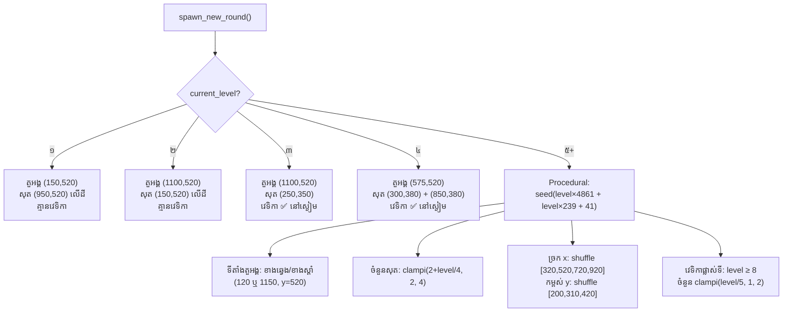

# ការបង្កើតកម្រិតស្វ័យប្រវត្តិ

**ឯកសារ៖** `Script/main.gd` (២៣២ បន្ទាត់)
**ប្រភេទ៖** `extends Node2D`

នេះគឺជាផ្នែកដែលធ្វើឱ្យ Target Quest ពិសេស៖ កម្រិតមិនចេះចប់។
កម្រិត ១–៤ រចនាដោយដៃ ហើយពីកម្រិត ៥ ឡើងទៅ ការរៀបចំត្រូវបានបង្កើត
ដោយ **ក្បួនដោះស្រាយគណិតវិទ្យា** ដែលអាចទាយបាន (deterministic)។

## ១. Deterministic Randomness — `seed()`

```gdscript
# main.gd បន្ទាត់ ៧៨–៨១
# បង្កើត seed តែមួយគត់ពីលេខកម្រិត
var unique_seed = current_level * 4861 + current_level * 239 + 41
seed(unique_seed)   # កំណត់ស្ថានភាព RNG ទាំងមូល
```

**ហេតុអ្វីសំខាន់?** ក្នុង Godot `shuffle()` និង `randi()` ប្រើ RNG សកល។
បើកំណត់ `seed(x)` ដូចគ្នា → លទ្ធផលចៃដន្យ **ដូចគ្នាជានិច្ច**។

- កម្រិត ៥ → seed = ៥×៤៨៦១ + ៥×២៣៩ + ៤១ = **២៥៥៤១**
- គ្រប់អ្នកលេងទាំងអស់ គ្រប់ម៉ាស៊ីនទាំងអស់ នៅកម្រិត ៥ ឃើញ layout **ដូចគ្នា**
- លេខ ៤៨៦១ និង ២៣៩ ជាចំនួនបឋម (prime numbers) — ជួយឱ្យ seed មិនបង្កើត
  លំនាំងាយៗទេ (ជម្រើសរបស់អ្នកបង្កើតដើម មិនមានការពន្យល់ក្នុងកូដទេ —
  នេះជាការបកស្រាយសមហេតុផល មិនមែនជាផ្ទៀងផ្ទាត់ពីប្រភពផ្លូវការទេ)

📖 [seed() — @GDScript](https://docs.godotengine.org/en/4.3/classes/class_%40gdscript.html#class-gdscript-method-seed)

## ២. ការជ្រើសរើសទីតាំងតួអង្គ

```gdscript
# main.gd បន្ទាត់ ៨៣–៨៨
var p_sides = [120.0, 1150.0]          # ខាងឆ្វេង ឬខាងស្តាំ
var p_x = p_sides[current_level % 2]   # ឆ្លាស់គ្នាតាមភាពគូ/សេស
player_pos = Vector2(p_x, 520.0)       # y នៅលើដីជានិច្ច
```

| លេខកម្រិត | `level % 2` | ទីតាំងតួអង្គ |
| --- | --- | --- |
| ៥ (សេស) | ១ | (1150, 520) — ស្តាំ |
| ៦ (គូ) | ០ | (120, 520) — ឆ្វេង |
| ៧ (សេស) | ១ | (1150, 520) — ស្តាំ |

ការឆ្លាស់ខាងធ្វើឱ្យអ្នកលេងត្រូវបាញ់ទិសផ្ទុយឆ្លាស់គ្នារាល់កម្រិត — ការហ្វឹកហាត់ទិសដៅ។

## ៣. ចំនួនគោលដៅតាមកម្រិត

```gdscript
# main.gd បន្ទាត់ ៩១
var target_count = clampi(2 + int(current_level / 4), 2, 4)
```

!!! warning "ចំណាំអំពីការបកស្រាយកូដ"
    ក្នុង GDScript `current_level / 4` ជា **integer division** (int/int) ដូច្នេះ
    `int()` គ្រាន់តែជាសំណួរសុវត្ថិភាព។ តារាងលទ្ធផល (គណនាដោយដៃពីរូបមន្ត)៖

| កម្រិត | `2 + level/4` | clamp(2..4) → ចំនួនសុត |
| --- | --- | --- |
| ៥–៧ | ៣ | **៣** |
| ៨–១១ | ៤ | **៤** |
| ១២+ | ៥, ៦, ... | **៤** (clamp អតិបរមា) |

ចាប់ពីកម្រិត ៨ ចំនួនសុតថេរនៅ ៤ — ការលំបាកកើនតាម **វេទិកាផ្លាស់ទី** ជំនួសវិញ។

## ៤. ប្រព័ន្ធ "ច្រក" (Lane System) — ការពារការត្រួតគ្នា

```gdscript
# main.gd បន្ទាត់ ៩៣–១១២
# ច្រកបញ្ឈរ ៤ (តម្លៃ x ដាច់ដោយឡែក ឃ្លាតគ្នា ២០០ px)
var available_lanes = [320.0, 520.0, 720.0, 920.0]
available_lanes.shuffle()   # ច្របល់ដោយចៃដន្យ (តាម seed)

# កម្ពស់ ៣ (តម្លៃ y ឃ្លាតគ្នា ១១០ px)
var available_heights = [200.0, 310.0, 420.0]
available_heights.shuffle()

var positions: Array[Vector2] = []
for i in range(target_count):
    var cx = available_lanes[i]                      # សុតនីមួយៗនៅច្រកផ្សេងគ្នា
    var cy = available_heights[i % available_heights.size()]  # កម្ពស់វិលជុំ
    positions.append(Vector2(cx, cy))
```

**ហេតុអ្វីមិនត្រួតគ្នា?** ដោយសារ `target_count ≤ 4` ហើយមានច្រក ៤
សុតនីមួយៗទទួលតម្លៃ x **ដាច់ដោយឡែក** (យកពី array តាម index)។
ចម្ងាយអប្បបរមារវាងសុត = ២០០ px (គម្លាតច្រក)។

!!! info "ការកត់សម្គាល់ពីសវនកម្ម"
    README ដើមហៅនេះថា "strict minimum safe-distance algorithm"។
    តាមពិតកូដ វាជា **ប្រព័ន្ធច្រកថេរ (fixed lane grid)** — សាមញ្ញ និងមាន
    ប្រសិទ្ធភាព ប៉ុន្តែមិនមែនជា distance-checking algorithm ទេ។
    ឯកសារខ្មែរនេះពណ៌នាតាមកូដពិត។

ចំណាំ៖ សុតអាចនៅ **កម្ពស់ដូចគ្នា** បាន (ឧ. សុតទី ១ និងទី ៤ អាចមាន y ដូចគ្នា
ព្រោះ `i % 3` វិលជុំ) ប៉ុន្តែ x ខុសគ្នា ដូច្នេះមិនត្រួតគ្នាទេ។

## ៥. វេទិកាផ្លាស់ទី (កម្រិត ៨+)

```gdscript
# main.gd បន្ទាត់ ១១៥ និង ១២៦–១៣៨
var use_mov = current_level >= 8    # ⚠️ README ដើមថា "Level 10" — កូដពិតគឺ ៨

# ក្នុង spawn_level_entities():
if use_moving and positions.size() > 0:
    var count = clampi(int(current_level / 5), 1, 2)  # ចំនួនវេទិកាដែលផ្លាស់ទី
    var available = range(positions.size())
    available.shuffle()
    for i in range(min(count, available.size())):
        moving_indices.append(available[i])   # ជ្រើសរើសដោយចៃដន្យ
```

| កម្រិត | `int(level/5)` | clamp(1..2) → វេទិកាផ្លាស់ទី |
| --- | --- | --- |
| ៨–៩ | ១ | **១** |
| ១០–១៤ | ២ | **២** |
| ១៥+ | ៣+ | **២** (clamp អតិបរមា) |

### ចលនា Tween — `apply_butter_smooth_movement()`

```gdscript
# main.gd បន្ទាត់ ១៩៣–២១១ (comment ខ្មែរ)
func apply_butter_smooth_movement(node: Node2D, level: int) -> void:
    var initial_y = node.position.y

    # ចម្ងាយផ្លាស់ទីកើនតាមកម្រិត តែមិនលើស ៣៥ px
    var move_dist = min(18.0 + (level * 0.4), 35.0)
    # ល្បឿន (វិនាទីក្នុងមួយជើង) — យឺតជាងមុនបន្តិចតាមកម្រិត តែមិនយឺតជាង ១.៦ វិនាទី
    var speed = max(1.6, 2.8 - (level * 0.01))

    # Tween រង្វិលជុំមិនឈប់
    var tween = node.create_tween().set_loops()
    tween.set_trans(Tween.TRANS_SINE).set_ease(Tween.EASE_IN_OUT)

    tween.tween_property(node, "position:y", initial_y - move_dist, speed)       # ឡើងលើ
    tween.tween_property(node, "position:y", initial_y + move_dist, speed * 2.0) # ចុះក្រោម (យឺត ២ ដង)
    tween.tween_property(node, "position:y", initial_y, speed)                   # ត្រឡប់កណ្តាល
```

តារាងលទ្ធផលតាមកម្រិត (គណនាពីរូបមន្ត)៖

| កម្រិត | move_dist | speed (វិនាទី) | អារម្មណ៍ |
| --- | --- | --- | --- |
| ៨ | ២១.២ px | ២.៧២ | រំកិលយឺតៗ |
| ២០ | ២៦.០ px | ២.៦០ | ចម្ងាយកើន |
| ៤២.៥+ | ៣៥ px (cap) | ២.៣៧៥ | ចម្ងាយអតិបរមា |
| ១២០+ | ៣៥ px | ១.៦ (floor) | លឿនបំផុត |

`TRANS_SINE` + `EASE_IN_OUT` = ចលនាដូចរលក sine — ចាប់ផ្តើម/ឈប់យឺតៗ
គ្មានការ "ជើក" (jerk)។ រយៈពេលចុះក្រោម = ២ ដងនៃឡើងលើ ដូច្នេះចលនា
មានអារម្មណ៍ដូចការអណ្តែត។

📖 [Tween](https://docs.godotengine.org/en/4.3/classes/class_tween.html) ·
[create_tween()](https://docs.godotengine.org/en/4.3/classes/class_node.html#class-node-method-create-tween)

## ៦. ការដាក់សុតលើវេទិកា

```gdscript
# main.gd បន្ទាត់ ១៤១–១៩០ (សង្ខេប)
for i in range(positions.size()):
    var pos = positions[i]
    var base = null

    if use_bases and wooden_base_scene:
        base = wooden_base_scene.instantiate()
        add_child(base)
        base.global_position = pos
        current_bases.append(base)      # ចងចាំសម្រាប់សម្អាតកម្រិតក្រោយ

        if i in moving_indices:
            apply_butter_smooth_movement(base, current_level)

    if egg_scene:
        var egg = egg_scene.instantiate()
        if base != null:
            base.add_child(egg)          # ★ សុតជាកូនរបស់វេទិកា
            egg.position = Vector2(0.0, -50.0)   # ៥០ px ពីលើវេទិកា
        else:
            add_child(egg)               # គ្មានវេទិកា → នៅលើដី
            egg.global_position = pos

        if not egg.is_in_group("eggs"):
            egg.add_to_group("eggs")     # សម្រាប់ការរាប់ក្នុង _process

        var egg_health = 2 + int(current_level / 3)
        if egg.has_method("set_egg_health"):
            egg.set_egg_health(egg_health)   # (⚠️ មិនមានឥទ្ធិពលជាក់ស្តែង — មើលមេរៀនសុត)
```

ចំណុចសំខាន់៖ **សុតជាកូនរបស់វេទិកា** — ដូច្នេះពេល Tween រំកិលវេទិកា
សុត (និងព្រួញដែលខ្ទប់នឹងសុត/វេទិកា) ផ្លាស់ទីតាមដោយស្វ័យប្រវត្តិ។
នេះជាអំណាចនៃ parent-child transform របស់ Godot។

## ៧. ផែនទីកម្រិតពេញលេញ



## លំហាត់

1. **ទាយ seed៖** តើកម្រិត ៦ មាន seed ប៉ុន្មាន? (៦×៤៨៦១ + ៦×២៣៩ + ៤១ = **៣០៦៤១**)
2. **ពិសោធន៍ determinism៖** លេងដល់កម្រិត ៥ ចាំ layout រួចចេញពីហ្គេម
   ហើយលេងម្តងទៀត — layout ដូចគ្នាទេ? (បាទ/ចាស ព្រោះ seed ដូចគ្នា)
3. **គណនា៖** កម្រិត ៣០ មានសុតប៉ុន្មាន វេទិកាផ្លាស់ទីប៉ុន្មាន?
   (សុត = clamp(2+7, 2, 4) = ៤; វេទិកាផ្លាស់ទី = clamp(6, 1, 2) = ២)
4. **កែកូដ៖** ធ្វើឱ្យវេទិកាផ្លាស់ទីចាប់ពីកម្រិត ៥ ជំនួស ៨ —
   មើល [មេរៀនបង្រៀន ជំហានទី ៥](../tutorials/customize.md)។

---

**បន្ទាប់៖** [មេរៀនបង្រៀនជាក់ស្តែង — កែប្រែហ្គេម →](../tutorials/customize.md)
