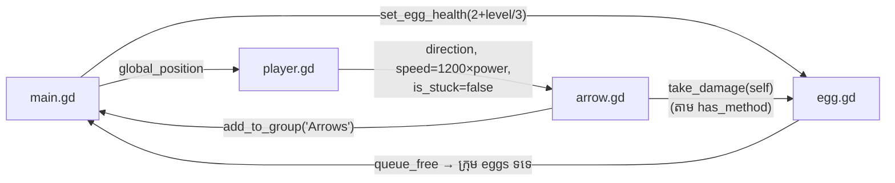

# ស្គ្រីប និងអនុគមន៍ (API Reference)

ឯកសារយោងនេះរាយបញ្ជី **អថេរ និងអនុគមន៍ពិតទាំងអស់** ក្នុងស្គ្រីបទាំង ៥
នៃគម្រោង។ រាល់ព័ត៌មានផ្ទៀងផ្ទាត់ពីកូដនៅ commit `a10b33c`។
លេខបន្ទាត់អាចប្រែប្រួលបើ upstream ផ្លាស់ប្តូរ។

---

## `Script/main.gd` — អ្នកគ្រប់គ្រងកម្រិត

**ប្រភេទ៖** `extends Node2D` · **ភ្ជាប់នឹង៖** `Scenes/main.tscn`

### អថេរ

| ឈ្មោះ | ប្រភេទ | លំនាំដើម | បន្ទាត់ | ការពិពណ៌នា |
| --- | --- | --- | --- | --- |
| `player` | Node | `$Player` (@onready) | ៥ | យោងទៅតួអង្គក្នុង scene |
| `egg_scene` | `PackedScene` | — (@export) | ៨ | scene សុត (កំណត់ក្នុង `main.tscn` → `egg.tscn`) |
| `wooden_base_scene` | `PackedScene` | — (@export) | ១១ | scene វេទិកាឈើ (កំណត់ក្នុង `main.tscn`) |
| `current_bases` | `Array` | `[]` | ១៤ | វេទិកាសកម្មទាំងអស់ — សម្រាប់សម្អាតពេលបញ្ចប់កម្រិត |
| `current_level` | `int` | `1` | ១៧ | លេខកម្រិតបច្ចុប្បន្ន |

### អនុគមន៍

| អនុគមន៍ | បន្ទាត់ | ការពិពណ៌នា |
| --- | --- | --- |
| `_ready() -> void` | ២០–២២ | ហៅ `spawn_new_round()` ម្តងពេលចាប់ផ្តើម |
| `spawn_new_round() -> void` | ២៥–១២២ | សម្អាតព្រួញ/វេទិកាចាស់ → បង្កើត layout តាមកម្រិត → ដាក់តួអង្គ |
| `spawn_level_entities(positions: Array[Vector2], use_bases: bool, use_moving: bool) -> void` | ១២៥–១៩០ | instantiate វេទិកា+សុត តាមទីតាំង; ជ្រើសរើសវេទិកាផ្លាស់ទី; កំណត់សុខភាពសុត |
| `apply_butter_smooth_movement(node: Node2D, level: int) -> void` | ១៩៣–២១១ | បង្កើត looping Tween (TRANS_SINE, EASE_IN_OUT) ឱ្យវេទិការំកិលឡើង-ចុះ |
| `_process(_delta: float) -> void` | ២១៤–២៣២ | រាប់សុតសកម្មក្នុងក្រុម `"eggs"` — បើសូន្យ → `current_level += 1` + `spawn_new_round()` |

**ក្រុមដែលប្រើ៖** `"Arrows"` (អាន — សម្អាត), `"eggs"` (អាន+សរសេរ — រាប់/ដាក់សុតចូល)

---

## `Script/player.gd` — តួអង្គ និងធ្នូ

**ប្រភេទ៖** `extends CharacterBody2D` · **ភ្ជាប់នឹង៖** `Scenes/player.tscn`

### អថេរ

| ឈ្មោះ | ប្រភេទ | លំនាំដើម | បន្ទាត់ | ការពិពណ៌នា |
| --- | --- | --- | --- | --- |
| `animation_player` | `AnimationPlayer` | `$AnimationPlayer` (@onready) | ៤ | គ្រប់គ្រង animation idle/shoot |
| `bow_hold_position` | `Marker2D` | ផ្លូវជ្រៅក្នុងដៃស្តាំ (@onready) | ៧ | ចំណុចកាន់/បាញ់ព្រួញ |
| `arrow_scene` | `PackedScene` | — (@export) | ១០ | scene ព្រួញ (កំណត់ក្នុង `player.tscn` → `arrow.tscn`) |
| `current_arrow` | `Node2D` | `null` | ១៣ | ព្រួញដែលកំពុងកាន់ |
| `is_charging` | `bool` | `false` | ១៦ | កំពុងទាញធ្នូឬទេ |
| `drag_start_pos` | `Vector2` | `Vector2.ZERO` | ១៩ | ទីតាំងកណ្តុរពេលចាប់ផ្តើមចុច |
| `max_drag_distance` | `float` | `200.0` (@export) | ២២ | ចម្ងាយទាញ = កម្លាំង ១០០% |
| `gravity` | `float` | `980.0` (ពី ProjectSettings) | ២៥ | ទំនាញសម្រាប់តួអង្គ |
| `train_offset` | `float` | `0.0` | ២៨ | offset ធ្វើឱ្យចំណុចគន្លងរំកិល (animate) |

### អនុគមន៍

| អនុគមន៍ | បន្ទាត់ | ការពិពណ៌នា |
| --- | --- | --- |
| `_ready() -> void` | ៣១–៣៣ | លេង animation `"idle"` |
| `_physics_process(delta) -> void` | ៣៦–១០៥ | ទំនាញ + ការគ្រប់គ្រង charging (aim, flip, torso rotation, animation seek) + `move_and_slide()` |
| `_input(event) -> void` | ១០៨–១១៧ | កណ្តុរឆ្វេង pressed → `start_charge()`; released → `release_arrow()` |
| `start_charge() -> void` | ១២០–១៤៥ | កំណត់ស្ថានភាព charging; instantiate ព្រួញទៅ `bow_hold_position`; បង្កក (`is_stuck = true`) |
| `update_trajectory() -> void` | ១៤៨–១៤៩ | ⚠️ អនុគមន៍ទទេ (`pass`) — សំណល់ placeholder មិនប្រើ |
| `_draw() -> void` | ១៥២–១៨៧ | គូរចំណុចស ៥ តាមរូបមន្ត projectile (dt=0.08, speed=1200×power, g=980) |
| `release_arrow() -> void` | ១៩០–២៤២ | reparent ព្រួញទៅ current_scene; កំណត់ `direction`/`speed`/`is_stuck=false`; លេងសំឡេង+animation; `await` → idle |

**ចំណាំ៖** `player.gd` មិនមាន `_ready()` ដែលហៅ `add_to_group("Player")` ទេ —
មើល [troubleshooting](../troubleshooting.md)។

---

## `Script/arrow.gd` — ព្រួញ

**ប្រភេទ៖** `extends Area2D` · **ភ្ជាប់នឹង៖** `Scenes/arrow.tscn`

### អថេរ

| ឈ្មោះ | ប្រភេទ | លំនាំដើម | បន្ទាត់ | ការពិពណ៌នា |
| --- | --- | --- | --- | --- |
| `speed` | `float` | `800.0` (@export) | ៤ | ល្បឿនដំបូង — ⚠️ `player.gd` ជំនួសដោយ `1200×power` ជានិច្ច |
| `direction` | `Vector2` | `Vector2.RIGHT` | ៧ | ទិសហោះ (កំណត់ដោយ player ពេលបាញ់) |
| `is_stuck` | `bool` | `false` | ១០ | ខ្ទប់ហើយឬនៅ (ក៏ប្រើជា "flag បង្កក" ពេលកាន់ក្នុងដៃ) |
| `custom_gravity` | `float` | `980.0` (ពី ProjectSettings) | ១៣ | ទំនាញ |
| `velocity` | `Vector2` | `Vector2.ZERO` | ១៦ | វ៉ិចទ័រល្បឿនបច្ចុប្បន្ន |
| `ray_cast` | `RayCast2D` | `$RayCast2D` (@onready) | ១៩ | ឧបករណ៍រកការប៉ះ (detect) (ប្រវែង ១៤៥ px តាម `arrow.tscn`) |

### អនុគមន៍

| អនុគមន៍ | បន្ទាត់ | ការពិពណ៌នា |
| --- | --- | --- |
| `_ready() -> void` | ២២–៣៦ | ចូលក្រុម `"Arrows"`; ស្វែងរកក្រុម `"Player"` សម្រាប់ exception (⚠️ មិនដំណើរការជាក់ស្តែង — គ្មាន node ក្នុងក្រុម); បើក raycast + `collide_with_areas` |
| `_process(delta) -> void` | ៣៩–៧៥ | Euler integration (`velocity.y += g×delta`, `position += velocity×delta`); បង្វិលតាម `velocity.angle()`; raycast → ignore ព្រួញផ្សេង, `take_damage()`, `stick_arrow()` |
| `stick_arrow(hit_point: Vector2, collider: Node) -> void` | ៧៨–១២១ | បញ្ឈប់ចលនា; តម្រូវច្រមុះទៅ hit_point; `z_index = -1`; លេងសំឡេងតាម node កូន (`BaseAudio`/`GrassAudio`/`HitAudio`); reparent ទៅ collider ដោយរក្សា `global_transform`; `set_process(false)` |

**ក្រុមដែលប្រើ៖** `"Arrows"` (សរសេរ — ចូលខ្លួនឯង; អាន — រំលងព្រួញផ្សេង), `"Player"` (អាន — មិនដំណើរការ)

---

## `Script/egg.gd` — សុតគោលដៅ

**ប្រភេទ៖** `extends CharacterBody2D` · **ភ្ជាប់នឹង៖** `Scenes/egg.tscn`

### អថេរ

| ឈ្មោះ | ប្រភេទ | លំនាំដើម | បន្ទាត់ | ការពិពណ៌នា |
| --- | --- | --- | --- | --- |
| `anim_sprite` | `AnimatedSprite2D` | `$AnimatedSprite2D` (@onready) | ៤ | បង្ហាញ frame ប្រេះ |
| `max_hits` | `int` | `3` | ៧ | សុខភាពអតិបរមា — ⚠️ **មិនត្រូវបានប្រើ** ក្នុងលក្ខខណ្ឌបំផ្លាញ (bug) |
| `current_hits` | `int` | `0` | ១០ | ចំនួនព្រួញដែលបានវាយ |
| `hit_arrows` | `Array` | `[]` | ១៣ | ព្រួញដែលបានវាយរួច (deduplication) |
| `is_destroyed` | `bool` | `false` | ១៦ | សុតបែកហើយឬទេ |
| `custom_gravity` | `float` | `980.0` (ពី ProjectSettings) | ១៩ | ទំនាញ |

### អនុគមន៍

| អនុគមន៍ | បន្ទាត់ | ការពិពណ៌នា |
| --- | --- | --- |
| `_ready() -> void` | ២២–៣១ | play+pause animation `"damage"` នៅ frame ០; reset ស្ថានភាព |
| `_physics_process(delta) -> void` | ៣៤–៥៦ | ទំនាញ + `move_and_slide()`; ពិនិត្យ slide collision រកព្រួញ → `take_damage()` |
| `set_egg_health(health: int) -> void` | ៥៩–៦៨ | កំណត់ `max_hits` + reset ស្ថានភាពទាំងអស់ (ហៅដោយ `main.gd`) |
| `take_damage(damager: Node2D) -> void` | ៧១–១០៦ | dedup; `current_hits += 1`; សំឡេង; frame ប្រេះ; ⚠️ លក្ខខណ្ឌបំផ្លាញ hard-coded `>= 3`; លុបព្រួញជាប់; ព្យាយាមហៅ `_on_egg_destroyed()` (guarded — main.gd គ្មាន); `queue_free()` |

**ក្រុមដែលប្រើ៖** `"Arrows"` (អាន — ស្គាល់ព្រួញក្នុង slide collision)។
សុតចូលក្រុម `"eggs"` ដោយ `main.gd` (មិនមែនដោយ `egg.gd` ខ្លួនឯងទេ)។

---

## `Script/target.gd` — ⚠️ Dead code (មិនប្រើ)

**ប្រភេទ៖** `extends Area2D` · **ភ្ជាប់នឹង៖** ❌ គ្មាន scene ណាប្រើ

| សមាជិក | បន្ទាត់ | ចំណាំ |
| --- | --- | --- |
| `max_health` (@export, int, 3) | ៣ | — |
| `current_health` (int, 3) | ៤ | ⚠️ មិន sync ជាមួយ `max_health` ពេល declare |
| `animated_sprite` (@onready) | ៦ | យោង `$AnimatedSprite2D` |
| `_ready()` | ៨–១២ | លេង animation `"fly"` បើមាន |
| `set_egg_health(h: int)` | ១៤–១៦ | ដូច egg.gd ប៉ុន្តែមិន reset sprite |
| `destroy_egg()` | ១៨–៣២ | បន្ថយសុខភាព; លេង `"dead"`; ហៅក្រុម `"level_manager"` → `check_level_completion()` — ⚠️ **ក្រុម និង method ទាំងនេះមិនមានក្នុងគម្រោងទេ**; មាន comment ជាភាសា Hindi (បន្ទាត់ ២៦) |

សន្និដ្ឋានពីសវនកម្ម៖ សំណល់ពីការពិសោធន៍ដំបូង (ពេលគោលដៅជា "monster ហោះ")។
រក្សាទុកក្នុង repo ដើម្បីភាពស្របគ្នាជាមួយ upstream ប៉ុន្តែ **កុំយកវាជាគំរូ**។

---

## អន្តរកម្មរវាងស្គ្រីប (Cross-reference)

📖 ឯកសារផ្លូវការ៖ [GDScript reference](https://docs.godotengine.org/en/4.3/classes/class_%40gdscript.html) ·
[Static typing](https://docs.godotengine.org/en/4.3/tutorials/scripting/gdscript/static_typing.html)
